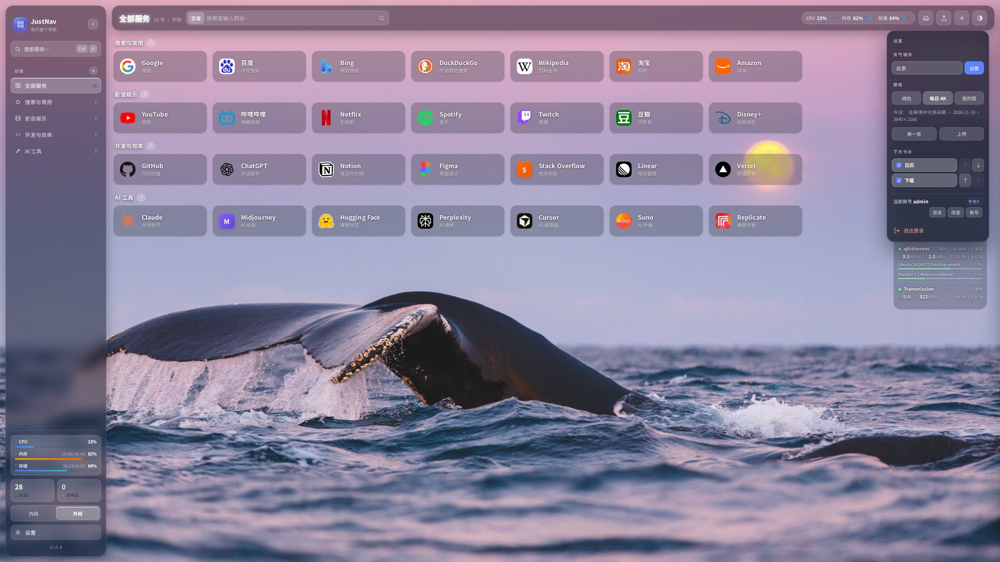

# JustNav 🔖

> 一个只做导航的导航页。不塞信息流，不做容器管理面板，不当监控大屏。

[](LICENSE)
[](https://github.com/fenglibo51/justnav/releases)
[](https://github.com/fenglibo51/justnav/pkgs/container/justnav)


---

## 📌 这个项目为什么存在

自用导航页原本用 [sun-panel](https://github.com/hslr-s/sun-panel)。两个问题促成了这个项目：

- 🚪 **它已经闭源** —— 作者为变现加入 PRO 功能，开源版永久停在 `v1.3.0`，后续 release 只有闭源二进制
- 🧩 **功能越堆越多** —— 内置 Docker 管理、内置 SSH 小窗、多账号体系……而每天真正用的只有「点一下打开某个服务」

调研了 GitHub 上的同类项目后，结论是**市场在奖励堆功能**：纯导航的天花板约 1.2 万星，而信息流仪表盘能到 3.8 万。这条路没人认真做。

所以这个项目的取舍很明确：

```
做        打开服务、找服务、管理服务入口
不做      RSS / 股票 / 容器启停 / 终端 / 权限体系 / AI 助手
```

只有一个例外：右侧栏允许放**信息型卡片**（时钟、日历、下载进度）。理由是这些是「看一眼就走」的信息，不是需要交互的功能模块。

---

## 🖼️ 界面

### 桌面端：左侧栏找服务，中间看服务，右侧栏看状态

左边是分组导航 + 全局搜索，中间是按分组铺开的服务卡片，右边是时钟卡和它下方的工具卡片。

材质跟着壁纸走，分两种：

```
有壁纸    暗玻璃 + 白字，文字自带投影 —— 换任何壁纸都不会出现「浅色壁纸上看不清字」
纯色底    浅色玻璃 + 深色字；时钟这类纯文字信息直接浮在背景上，不加底框
```

两种模式下排布完全一致，只换颜色，不会出现「关掉壁纸整个界面变了个样」。

### 右侧栏：可以挂多张卡片，顺序自己排


时钟卡下方是一个**卡片槽位**，目前支持两种卡片，可以同时开、可以调顺序：

```
📅 日历     公历 + 农历 + 节假日 + 节日倒计时，月份可前后翻
⬇️ 下载     接 qBittorrent / Transmission，看总的上下行和正在跑的任务
```

设置里勾选控制显示，`↑` `↓` 箭头调上下顺序。放不下就整体滚动，**卡片不会被压扁**。

### 设置面板：不跳页，就地改



所有设置在右侧弹层里改，改完立即生效，不刷新页面。壁纸强度、搜索引擎、卡片排布、账号管理都在这一层。

### 手机端：底部 tab，卡片两列


手机端自动切成底部 tab 布局，卡片两列。长按卡片 3 秒进入整理模式，可以拖拽排序、改分组。

---

## ✨ 功能

- 🔀 **内外网双地址** —— 每个条目配内网 + 外网地址，全局一键切换
- 🔍 **搜索框** —— 常驻顶栏：匹配本地条目 / 直接打开网址 / 用百度或谷歌搜；
  引擎可增删改，`⌘K` 或 `/` 聚焦
- 🖼️ **每日 4K 壁纸** —— Bing 每日 UHD，本地缓存，30 天 / 300MB 自动清理（可关闭）
- 🎨 **壁纸强度三档** —— 清晰（默认，壁纸不被遮罩洗掉）/ 平衡 / 毛玻璃
- 🕐 **时钟 + 天气** —— 大时钟 + 当前温度 / 天气 / 今日高低温，城市可搜索切换，10 分钟刷新
- 📅 **日历卡片** —— 公历 + 农历 + 法定节假日（含调休）+ 节日倒计时
- ⬇️ **下载器卡片** —— 后端代理 qBittorrent / Transmission，密码不出后端
- 🧩 **多卡片 + 自定义顺序** —— 右侧栏挂几张、谁在上面，自己定
- 🖥️ **双端布局** —— 桌面侧边栏 + 手机底部 tab，深浅双主题
- 🏷️ **Docker 标签发现** —— 带 `nav.*` 标签的容器进「待收录」，人工确认后才上首页
- 📦 **单二进制部署** —— 无外部数据库，`FROM scratch`，多架构镜像

---

## 🚀 快速开始

### Docker（推荐）

```bash
docker run -d \
  --name justnav \
  -p 8522:8522 \
  -v ./data:/data \
  --restart unless-stopped \
  ghcr.io/fenglibo51/justnav:latest
```

打开 `http://你的IP:8522`，默认账号 **`admin` / `admin`**，登录后立刻去「设置 → 改密码」。

> ⚠️ 默认密码是硬编码的 `admin`，不是随机生成 —— 部署在能被别人访问到的网络上就必须改。
> 想第一次启动就用自定义密码，加 `-e JUSTNAV_PASSWORD=你的密码`（**只在还没有任何账号时生效**，之后不会覆盖你在界面上改的密码）。

### Docker Compose

```yaml
services:
  justnav:
    image: ghcr.io/fenglibo51/justnav:latest
    container_name: justnav
    restart: unless-stopped
    ports:
      - "8522:8522"
    environment:
      TZ: Asia/Shanghai
      JUSTNAV_SITE_NAME: JustNav
      # 改成你自己 NAS / 主机的内网地址
      JUSTNAV_INTERNAL_HOST: "192.168.1.10"
    volumes:
      - ./data:/data:rw
```

完整带注释的版本见 [`.env.example`](.env.example)。

### 源码

```bash
# 需 Go 1.24+
go run .

# 或编译
CGO_ENABLED=0 go build -trimpath -ldflags="-s -w" -o justnav .
./justnav
```

---

## ⚙️ 配置

全部走环境变量，都有默认值，不写死任何地址。

```
变量                          默认              说明
────────────────────────────────────────────────────────────────────────────
JUSTNAV_PORT                  8522             监听端口
JUSTNAV_DATA_DIR              ./data           数据目录（条目 + 壁纸缓存）
JUSTNAV_SITE_NAME             JustNav          站点标题
JUSTNAV_WALLPAPER             true             是否启用每日壁纸
JUSTNAV_WALLPAPER_KEEP_DAYS   30               壁纸保留天数
JUSTNAV_WALLPAPER_MAX_BYTES   314572800        壁纸缓存总容量上限（300MB）
JUSTNAV_PROBE                 true             是否探测服务在线状态
JUSTNAV_PROBE_INTERVAL_SEC    60               探测间隔
JUSTNAV_PROBE_TIMEOUT_SEC     4                单次探测超时
JUSTNAV_PROBE_THRESHOLD       2                连续失败几次判离线
JUSTNAV_PROBE_INSECURE       true             放行自签名证书
JUSTNAV_DOCKER_HOST           （空=自动发现）   Docker 地址，见「Docker 自动发现」
JUSTNAV_DOCKER_SCAN_ALL       true             扫所有有端口映射的容器（不要求打标签）
JUSTNAV_AUTH                  true             是否启用登录认证
JUSTNAV_USER                  admin            账号
JUSTNAV_PASSWORD              （空=自动生成）   初始密码，只在首次创建管理员时生效
JUSTNAV_COOKIE_SECURE         false            走 HTTPS 反代时设 true
JUSTNAV_INTERNAL_HOST         （空）            内网 IP/主机名，如 192.168.1.10
                                                「待收录」拼候选地址用它，走反代时必填
```

---

## 🔌 接口

全部返回 JSON，除 `/api/health` 外都需要登录（`JUSTNAV_AUTH=false` 时可关掉）。

```
认证
  GET    /api/auth/status          当前登录状态
  POST   /api/auth/login           登录
  POST   /api/auth/logout          登出

条目
  GET    /api/items                条目 + 分组 + 设置（前端一次拿全）
  POST   /api/items                新增 / 更新单条
  POST   /api/items/bulk           批量导入
  PUT    /api/items/order          调整条目顺序
  DELETE /api/items?id=            删除单条

分组
  POST   /api/groups               新增分组
  PUT    /api/groups               重命名分组
  PUT    /api/groups/order         调整分组顺序
  DELETE /api/groups               删除分组

设置
  POST   /api/settings             更新设置（壁纸强度 / 搜索引擎 / 卡片排布 / 天气城市…）

状态
  GET    /api/health               健康检查 + 版本号
  GET    /api/status               各条目在线探测结果
  GET    /api/sysinfo              宿主机 CPU / 内存 / 存储

图标
  GET    /api/favicon              抓站点 favicon
  GET    /api/icons/search         搜索图标库
  GET    /api/icons/get            取图标

壁纸
  GET    /api/wallpaper            壁纸元信息 + 缓存列表
  GET    /api/wallpaper/img?date=  取图
  POST   /api/wallpaper/refresh    立即抓一次
  POST   /api/wallpaper/upload     上传自定义壁纸

下载器
  GET    /api/downloaders          下载器状态（密码不出后端）
  POST   /api/downloaders/test     测试连接

天气
  GET    /api/weather              当前城市天气
  GET    /api/weather/search?q=    按城市名查经纬度

Docker 发现
  GET    /api/inbox                待收录候选

账号（仅管理员）
  GET    /api/users                账号列表
  POST   /api/users                新建账号
  PUT    /api/users/password       改密码
  PUT    /api/users/username       改用户名
  DELETE /api/users?id=            删除账号
```

前端在 `web/index.html`，运行时探测 `/api/health`：

```
通      → 读真实数据
不通    → 保持内置演示数据（单文件直接打开也能看，不白屏）
```

---

## 🔐 登录

首次启动且没设 `JUSTNAV_PASSWORD` 时，创建的管理员是 **`admin` / `admin`**，
启动日志里会有一行醒目警告：

```
[justnav] ⚠️  首次启动，已创建管理员：admin  密码：admin  —— 登录后请立刻改掉
```

`JUSTNAV_PASSWORD` 的语义是**「首次初始化密码」**：只在账号表为空时用一次，
之后重启不会覆盖你在界面上改过的密码（早期版本会覆盖，等于改密白改，已修）。

机制：

```
存储      data/users.json —— PBKDF2-HMAC-SHA256 哈希 + 会话签名密钥
会话      无状态签名 cookie；勾「记住我」30 天，不勾则关浏览器失效
限速      同一 IP 连续失败 5 次锁 5 分钟
改密码    重新生成签名密钥 → 所有旧会话立即失效
浏览器端  只存账号名，不存密码
```

### 多账号

不同账号看到**完全不同的导航页**（条目、分组、壁纸、主题、内外网设置都各自独立），
共用 Bing 每日壁纸缓存与状态探测调度。

```
data/users/<uid>/nav.json        每个账号自己的条目
data/users/<uid>/wallpaper.jpg   每个账号自己的自定义壁纸
data/wallpaper/                  Bing 每日缓存（共享，只下一份）
```

角色：

```
管理员    第一个账号；能新建/删除账号、重置别人的密码
普通用户  只能改自己的密码、管自己的导航
```

账号隔离是**数据目录级**的，不是一个文件里靠 userID 过滤 —— 漏一处过滤就会串号，
分目录不会。

⚠️ 这是「多个自用者分账号」，不是权限系统：普通用户仍然能改自己那套的全部内容，
没有只读/共享分组这类概念。

---

## 🏷️ Docker 自动发现（可选）

### 先说清楚容器数量

```
最小部署            1 个容器（justnav 自己）
要 Docker 自动发现   还是 1 个容器 —— 直接把 socket 挂进来
```

不想要「扫容器」这个功能的话，把 `JUSTNAV_DOCKER_HOST` 留空、也不挂 socket 就行，
导航、壁纸、状态探测、书签导入全部不受影响。

### 接法（挂 socket）

```yaml
    volumes:
      - ./data:/data:rw
      - /var/run/docker.sock:/var/run/docker.sock
```

环境变量可以不写 —— 程序启动时发现 `/var/run/docker.sock` 会自动用它。

### ⚠️ `:ro` 是假安全（这条最重要）

```
-v /var/run/docker.sock:/var/run/docker.sock:ro
```

看起来是只读，**实际上 `:ro` 只约束「这个文件能不能被写」，
完全不约束「这个 socket 提供的 API 能干什么」。** 挂上去之后，容器里的进程能：

```
读所有容器的环境变量    ← 里面通常全是数据库密码、API key
创建特权容器并挂载宿主机根目录
docker exec 进任何正在运行的容器
```

换句话说：**挂 socket ≈ 给宿主机 root。** 区别只是「这个程序愿不愿意调那些接口」，
而不是「能不能」。

### 危险组合（务必避开）

```
反代暴露到公网  +  socket 直挂
```

含义是：**任何人只要能利用这个应用的一个漏洞，就等于拿到你 NAS 的 root。**

本项目内置登录鉴权，但鉴权不等于防住 0day。**建议：只在内网用。**

### 不打标签也能用

socket 挂上后，`JUSTNAV_DOCKER_SCAN_ALL=true`（默认）会把**有端口映射的运行中容器**
都列为「待收录」候选，不打任何标签也能在界面上勾选收录。

```
会出现在待收录                    不会出现
──────────────────────────────────────────────────────
运行中                            已停止 / 已退出
有端口映射                         只有内部端口（数据库这类）
                                  justnav 自己
                                  带 nav.hide=true 的容器
```

### 想更精确就打标签（可选增强）

```
nav.enable=true
nav.name=Jellyfin
nav.url=http://192.168.1.10:8096
nav.url.external=https://jellyfin.example.com
nav.icon=film
nav.group=影音媒体
```

**标签只是建议，不是命令**：发现的服务进「待收录」，人工确认才进首页；
容器删了，已收录条目只置灰，不会自动消失。

---

## 🛠️ 构建镜像

镜像由 GitHub Actions 自动构建，推到 `ghcr.io/fenglibo51/justnav`：

```
触发方式    打 tag（v*）/ push 到 main / 手动 workflow_dispatch
架构        linux/amd64 + linux/arm64
标签        1.0.1 / 1.0 / latest（注意：镜像标签不带 v 前缀，v1.0.1 是 git tag）
```

本地构建：

```bash
docker build -t justnav:local --build-arg VERSION=dev .
```

版本号通过 `-ldflags -X justnav/internal/api.Version=$VERSION` 注入，
不打 build-arg 就是 `1.0.1`（源码里的兜底值）。

---

## ⚠️ 版权提醒

每日壁纸来自 Bing，图源为 Getty / 摄影师投稿。本项目**只在运行时下载并缓存在本地数据目录**，
仓库里不携带任何壁纸图片，`.gitignore` 已排除 `/data/`。自行部署时同理 —— 别把缓存提交上去。

README 里的截图使用演示数据（Jellyfin / Plex / Nextcloud 这类通用服务），不含任何真实内网信息。

## 📄 许可

[MIT](LICENSE)
